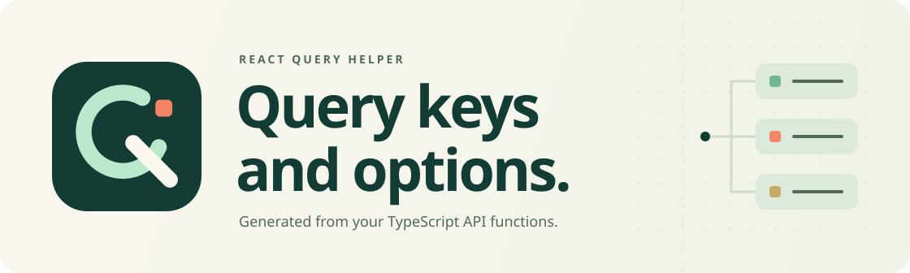

<p align="center">
  <picture>
    <source media="(prefers-color-scheme: dark)" srcset="https://raw.githubusercontent.com/uiwwsw/react-query-helper/main/assets/readme-hero-dark.svg" />
    
  </picture>
</p>

<h1 align="center">React Query Helper</h1>

<p align="center">
  TypeScript API 함수 파일에서 쿼리 키와 TanStack Query v5 옵션 팩토리(<code>queryOptions</code>, <code>infiniteQueryOptions</code>, <code>mutationOptions</code> 호출 코드)를 생성하는 CLI와 런타임 헬퍼입니다.
</p>

<p align="center">
  <a href="https://www.npmjs.com/package/@uiwwsw/react-query-helper"></a>
  <a href="https://github.com/uiwwsw/react-query-helper/blob/main/LICENSE"></a>
  <a href="https://github.com/uiwwsw/react-query-helper/actions/workflows/ci.yml"></a>
  <a href="https://tanstack.com/query"></a>
  <a href="https://www.npmjs.com/package/@uiwwsw/react-query-helper"></a>
  <a href="https://www.npmjs.com/package/@uiwwsw/react-query-helper"></a>
</p>

<p align="center">
  <a href="https://react-query-helper.vercel.app/">데모</a> ·
  <a href="https://github.com/uiwwsw/react-query-helper/blob/main/docs/ARCHITECTURE.md">구성과 의존성</a> ·
  <a href="https://www.npmjs.com/package/@uiwwsw/react-query-helper">npm</a> ·
  <a href="https://github.com/uiwwsw/react-query-helper/blob/main/CHANGELOG.md">변경 이력</a> ·
  <a href="https://github.com/uiwwsw/react-query-helper/blob/main/README_EN.md">English</a>
</p>

> **버전 안내:** 이 문서는 **2.x** 기준입니다. 실제 게시 버전은 위 npm 배지에서 확인하세요. 1.x를 사용 중이라면 [1.3.0 문서](https://github.com/uiwwsw/react-query-helper/blob/v1.3.0/README.md)와 [마이그레이션 가이드](https://github.com/uiwwsw/react-query-helper/blob/main/docs/REFERENCE.md#1x에서-이전)를 참고하세요. 아직 게시되지 않은 변경은 [소스에서 설치](https://github.com/uiwwsw/react-query-helper/blob/main/docs/REFERENCE.md#npm-게시-전-소스에서-설치하기)할 수 있습니다.

## 제공하는 것

- `init`: `rqh.config.ts` 시작 템플릿을 만듭니다. 기존 설정 파일은 덮어쓰지 않습니다.
- `generate`: `sourceDir`의 TypeScript 파일에서 최상위 함수를 읽어 `*Options.ts`를 생성합니다.
- 함수마다 키 상수 `<함수명>Key`를 생성합니다. 키는 소스 경로의 디렉토리, 파일명, 함수명으로 만듭니다.
- 함수마다 `queryOption`, `infiniteOption`, `mutationOption` 헬퍼를 호출하는 팩토리를 생성합니다.
- 함수 이름의 접두사(`get`, `list`, `create` 등)로 query, infinite, mutation 중 만들 종류를 정합니다. 설정으로 바꿀 수 있습니다.
- 인자가 둘 이상인 함수의 mutation에는 변수 객체 타입과 `mapVariablesToArgs`를 생성합니다.
- 팩토리의 `withOptions`로 `staleTime`, `select` 같은 TanStack Query 옵션을 덮어쓸 수 있고, 인자·반환·`select` 결과 타입이 추론됩니다.
- 같은 팩토리를 `useQuery`, `useSuspenseQuery`, `prefetchQuery`, `getQueryData`에서 재사용할 수 있습니다.
- `generate --check`: 파일을 쓰지 않고 누락·변경·오래된 결과가 있으면 종료 코드 1을 반환합니다.
- `watch`: 소스, 설정 파일, 직접 지정한 로컬 플러그인 파일이 바뀔 때 다시 생성합니다.
- 생성 파일 첫 줄에 소유 표시를 붙입니다. 표시가 있는 파일만 갱신하거나 삭제하고, 표시 없는 기존 파일은 덮어쓰지 않고 오류로 처리합니다.
- `customAnalyzerPath`, `customTemplatePath`로 분석기와 템플릿을 교체할 수 있습니다.

생성 규칙은 [설정으로 재정의](https://github.com/uiwwsw/react-query-helper/blob/main/docs/REFERENCE.md#생성-규칙)할 수 있습니다.

<a id="quick-start"></a>

## 설치와 사용

### 1. 설치하고 초기화

```sh
npm install @uiwwsw/react-query-helper@^2 @tanstack/react-query react
npx @uiwwsw/react-query-helper init
```

생성 코드가 이 패키지를 import하므로 `-D`가 아닌 일반 dependency로 설치합니다.
React와 TanStack Query가 이미 설치되어 있다면 필요한 의존성만 추가하세요.

### 2. API 경로 지정

`init`이 만든 `rqh.config.ts`의 경로를 앱 구조에 맞춥니다.
별도 플러그인이나 alias 설정 없이 시작할 수 있습니다.

```ts
// rqh.config.ts
import type { AutoQueryConfig } from "@uiwwsw/react-query-helper/config";

export default {
  sourceDir: "./libs",
  outputDir: "./src/options",
  ignoredFiles: ["domain.ts", "adaptor.ts", "**/*.test.ts", "**/*.spec.ts"],
  template: { artifactStrategy: "smart" },
} satisfies AutoQueryConfig;
```

실제 API 함수를 해당 디렉토리에 두세요. 아래는 흐름을 확인하기 위한 간단한 예시입니다.

```ts
// libs/users/api.ts
export const getUser = async (id: string) => ({ id, name: "Ada" });
```

### 3. 생성하고 사용

```sh
npx @uiwwsw/react-query-helper generate
```

입력 `libs/users/api.ts`에서 `src/options/users/apiOptions.ts`가 생성됩니다.
import 경로와 `Source root` 주석은 설정한 디렉토리 위치에 따라 달라집니다.

```ts
// Generated by @uiwwsw/react-query-helper. DO NOT EDIT.
// Source root: "../../libs"
import { getUser } from "../../../libs/users/api";
import {
  queryOption as __rqh_query,
  infiniteOption as __rqh_infinite,
} from "@uiwwsw/react-query-helper";

export const getUserKey = ["users", "api", "getUser"] as const;
export const getUserQueryOption = __rqh_query(getUserKey, getUser);
export const getUserInfiniteQueryOption = __rqh_infinite(getUserKey, getUser);
```

**생성 파일 대신 원본 API를 수정하세요.**
무한 쿼리 팩토리도 생성되지만 실제 페이지네이션 설정은 API에 맞게 별도로 지정합니다.

```tsx
// src/UserName.tsx
import { useQuery } from "@tanstack/react-query";
import { getUserQueryOption } from "./options/users/apiOptions";

export function UserName({ id }: { id: string }) {
  const user = useQuery(
    getUserQueryOption.withOptions(
      { staleTime: 60_000, select: (data) => data.name },
      id,
    ),
  );

  if (user.isPending) return <p>Loading...</p>;
  if (user.isError) return <p>{user.error.message}</p>;
  return <p>{user.data}</p>;
}
```

앱 상위에 `QueryClientProvider`가 필요합니다. 위의 `user.data`는 `select`에 따라
`string`으로 추론됩니다. 옵션은 훅 바깥에서도 재사용할 수 있습니다.

```ts
// 기존 QueryClient 인스턴스 client에서
await client.prefetchQuery(getUserQueryOption("u1"));
const cached = client.getQueryData(getUserQueryOption("u1").queryKey);
// { id: string; name: string } | undefined
```

### 4. 개발 흐름에 연결

```json
{
  "scripts": {
    "query:generate": "react-query-helper generate",
    "query:watch": "react-query-helper watch",
    "query:check": "react-query-helper generate --check"
  }
}
```

개발할 때는 `npm run query:watch`, 앱 CI에서는 `npm run query:check`를 실행하세요.
check는 파일을 수정하지 않고 누락·변경·오래된 결과를 발견하면 종료 코드 1을 반환합니다.
생성물을 커밋하지 않는 프로젝트라면 CI에서 `query:generate` 후 앱 타입 검사를 실행하세요.

## 제공하지 않는 것

- 훅. `useQuery` 등은 TanStack Query의 것을 그대로 씁니다.
- HTTP 클라이언트. 기존 API 함수를 그대로 호출합니다.
- 캐시, 재시도, `QueryClient`. 기본 정책은 TanStack Query/`QueryClient`를 따릅니다.
- OpenAPI 등 명세 파일 읽기. 입력은 TypeScript 소스 파일입니다.
- 페이지네이션과 요청 취소의 자동 추측. 커서 매핑과 `AbortSignal` 전달은 API에 맞춰 직접 설정합니다.
- re-export barrel, 클래스·객체 메서드, 고차 함수가 반환한 함수의 분석. 기본 대상은 최상위 함수입니다.
- 모든 generic/overload 관계를 옵션 팩토리 타입으로 보존하는 변환. 필요하면 구체적 wrapper나 custom template을 사용합니다.
- Node ESM에서 생성 파일을 직접 실행하는 용도. 생성 코드는 TS 번들러용입니다.
- React 또는 TanStack의 공식 프로젝트 지위. 독립적인 커뮤니티 도구입니다.

## 기반

- [TanStack Query](https://tanstack.com/query): 캐시, 재시도, `QueryClient`, 훅을 제공합니다. 생성 코드가 `queryOptions`, `infiniteQueryOptions`, `mutationOptions`를 호출합니다. peer dependency입니다.
- [TypeScript](https://www.typescriptlang.org): 컴파일러 API로 소스 파일을 파싱해 함수 목록을 추출합니다.
- [Prettier](https://prettier.io): 생성 결과를 포맷합니다.
- [Jiti](https://github.com/unjs/jiti): TypeScript 설정과 플러그인을 로드합니다.
- [picomatch](https://github.com/micromatch/picomatch): `ignoredFiles` glob을 처리합니다.
- [chokidar](https://github.com/paulmillr/chokidar): `watch`의 파일 감시에 씁니다.

OpenAPI 명세가 있다면 [Orval](https://orval.dev), [Kubb](https://kubb.dev), [Hey API](https://heyapi.dev) 같은 명세 기반 도구도 검토해 보세요. 비교와 한계는 [구성과 의존성](https://github.com/uiwwsw/react-query-helper/blob/main/docs/ARCHITECTURE.md)에 정리했습니다.

## 필요한 예제 찾기

| 하고 싶은 일                                           | 가이드                                                                                                          |
| ------------------------------------------------------ | --------------------------------------------------------------------------------------------------------------- |
| 설정 파일, 경로, ignore glob 변경                      | [설정](https://github.com/uiwwsw/react-query-helper/blob/main/docs/REFERENCE.md#설정)                           |
| 함수별 query/mutation 생성 제어                        | [생성 규칙과 캐시 키](https://github.com/uiwwsw/react-query-helper/blob/main/docs/REFERENCE.md#생성-규칙)       |
| mutation 인자, 취소, 옵션 확장                         | [런타임 옵션](https://github.com/uiwwsw/react-query-helper/blob/main/docs/REFERENCE.md#런타임-옵션)             |
| 커서 페이지네이션과 `maxPages`                         | [무한 쿼리](https://github.com/uiwwsw/react-query-helper/blob/main/docs/REFERENCE.md#무한-쿼리)                 |
| 기존 1.x 프로젝트 업그레이드                           | [마이그레이션 체크리스트](https://github.com/uiwwsw/react-query-helper/blob/main/docs/REFERENCE.md#1x에서-이전) |
| 지원하지 않는 문법, 커스텀 플러그인                    | [지원 범위와 확장](https://github.com/uiwwsw/react-query-helper/blob/main/docs/REFERENCE.md#범위와-확장)        |
| 테스트, 로컬 설치, npm 배포 설정                       | [개발과 배포](https://github.com/uiwwsw/react-query-helper/blob/main/docs/REFERENCE.md#개발과-배포)             |
| 모듈별 역할, 의존성, TanStack Query·유사 도구와의 관계 | [구성과 의존성](https://github.com/uiwwsw/react-query-helper/blob/main/docs/ARCHITECTURE.md)                    |
| 이번 개선의 근거와 남은 한계                           | [저장소 검토 기록](https://github.com/uiwwsw/react-query-helper/blob/main/docs/REVIEW.md)                       |

## 지원 환경과 주의점

| 구분           | 지원 기준                                          |
| -------------- | -------------------------------------------------- |
| Node.js        | CLI/빌드에 22 이상, CI는 22/24                     |
| React          | 18/19                                              |
| TanStack Query | `>=5.102.8 <6`                                     |
| TypeScript     | 5.8 이상, 생성 코드는 TS 번들러용                  |
| 브라우저       | 루트 import는 브라우저용, Node 도구는 별도 subpath |

- **2.x는 호환성을 깨는 변경입니다.** 기존 생성 파일을 옮긴 뒤 재생성하고, 수동 키와 persisted cache를 마이그레이션하세요.
- API 인자는 캐시 키에 포함됩니다. 직렬화 가능한 값만 전달하고 토큰·인증 헤더는 넣지 마세요.
- 페이지네이션과 요청 취소는 자동 추측하지 않습니다. 커서 매핑과 `AbortSignal` 전달은 API에 맞춰 설정하세요.
- 최상위 함수가 기본 대상입니다. re-export barrel, 메서드, 모든 generic/overload 관계를 처리하는 범용 TypeScript 변환기는 아닙니다.

## 데모

[한국어 데모](https://react-query-helper.vercel.app/) · [English demo](https://react-query-helper.vercel.app/en/)

데모는 이 패키지의 분석기와 생성기가 만든 query, mutation, infinite-query 출력을 보여 줍니다. 실제 API를 호출하지 않습니다. 배포 메모: [docs/SEO.md](https://github.com/uiwwsw/react-query-helper/blob/main/docs/SEO.md).

## 라이선스

[MIT License](https://github.com/uiwwsw/react-query-helper/blob/main/LICENSE) · [변경 이력](https://github.com/uiwwsw/react-query-helper/blob/main/CHANGELOG.md) · [로고와 브랜드 자산](https://github.com/uiwwsw/react-query-helper/blob/main/assets/README.md)
